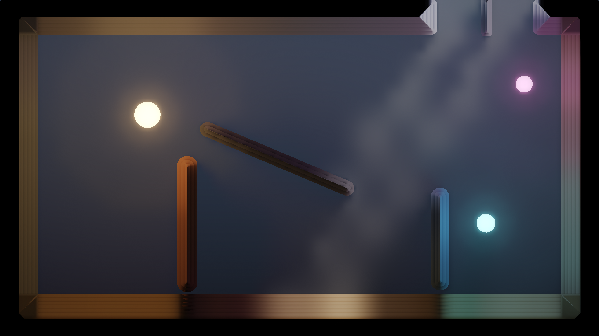

# love-cascade

Noiseless 2D global illumination via [radiance cascades](https://www.snn.ru.nl/~dmitry/interactive-rendering-course/sannikov.radiance+cascades.pdf), running entirely in shaders on **LÖVE 11.5** — GLSL 1.20, no compute shaders.



A hierarchy of radiance probes (spacing 4 px at cascade 0, doubling per level, 4 directions per probe doubling per level) is interval-raymarched against a signed distance field, merged top-down into cascade 0, integrated to diffuse irradiance, and composited against surface albedo. Light bounces because a per-pixel pass re-emits `albedo * irradiance-just-outside-the-surface` and the gather runs again — 2 extra iterations by default, which converges geometrically in surface albedo.

The scene is 640×360 scene pixels: the SDF is one texel per scene pixel and the probe grid is 160×90. Presentation layers are supersampled and Retina-aware (raster sizes are derived from the window's pixel factor, so the transport numbers are identical at 1x and 2x).

## Run

Requires [LÖVE 11.5](https://love2d.org). Then:

```sh
love .            # or: ./scripts/run.sh
```

`scripts/run.sh` uses `$LOVE_BIN` if set, otherwise `~/.local/opt/love.app/Contents/MacOS/love`.

## Controls

| Key | Effect |
| --- | --- |
| drag | move a light orb (two of them keep drifting where you drop them) |
| `0`–`8` | composite, cascade 0–4, irradiance, SDF, albedo views |
| `G` | global illumination on/off (flat ambient) |
| `S` | sun and sky |
| `B` | bloom |
| `N` | bounce iterations, cycles 0→3 |
| `M` | orb drift motion |
| `Space` | pause the animation |
| `R` | reset the scene |
| `Esc` | quit |

## Headless modes

| Command | What it proves |
| --- | --- |
| `./scripts/test.sh` | end-to-end gate: the far orb reaches probes B and C only through the coarse cascades and merging (behind an occluder), probe A stays in shadow, and a wall pixel is lit by the field. Prints `E_A/E_B/E_C`, wall and orb pixel values, then `[test] PASS` (exit 1 on any failure). |
| `./scripts/run.sh --bouncecheck` | analytic feedback gate: in a sealed cavity whose boundary emits `Le` and reflects `rho`, the iterated field must match the fixed point `Le/(1-rho)`, and successive deltas must shrink by `rho`. Also takes `--rho=` and `--le=`. |
| `./scripts/run.sh --shot` | writes `demo.png` to the LÖVE save directory at the fixed animation time. |
| `./scripts/run.sh --bench` | per-frame cost including the GPU (each frame is synced), `avg/min/max ms`. |

## Layout

```
main.lua            window, HUD, input, CLI modes, the assertion harness
src/config.lua      every tunable (scene size, cascade spacing, bounce count, presentation)
src/display.lua     HiDPI: point size vs device size per raster
src/radiance.lua    cascade hierarchy, render graph, uniform sends
src/scene.lua       primitives (SDF/albedo/emission rasters), demo and test scenes
src/shaders/        scene / cascade / irradiance / bounce / compose / bloom / present
scripts/            run.sh, test.sh
```
